# Beg1nnnerOS

Бесплатная программа для стримеров Twitch: музыка за баллы канала, чат-бот, МедиаАлерты, опросы и прогнозы,
модерация, оверлеи для OBS и многое другое — в одном окне, на вашем компьютере, без облачных сервисов.

**[⬇️ Скачать последнюю версию](https://github.com/beg1nnner/Beg1nnnerOS/releases/latest)** — установщик для Windows 10/11.
Программа сама предлагает обновиться, когда выходит новая версия. Что изменилось — в [CHANGELOG.md](CHANGELOG.md).

💬 Идеи и сообщения об ошибках — в Telegram: [@Beg1nnner](https://t.me/Beg1nnner) ·
💜 [Поблагодарить разработчика](https://www.donationalerts.com/r/beginner24)

## Возможности

### 🎵 Музыка за баллы канала

Зрители заказывают треки с YouTube, Яндекс Музыки и Spotify ссылкой или названием. Лимиты, фильтры, голосование !skip, приоритет VIP и подписчиков, честный возврат баллов.

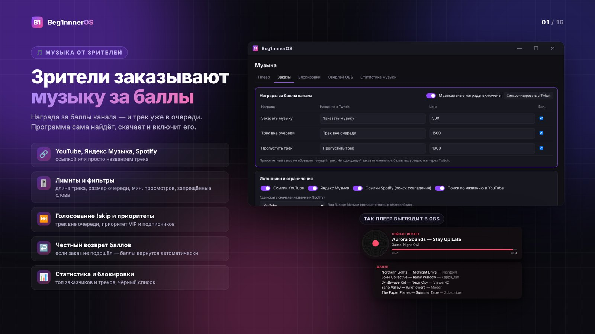

### 💬 Чат-бот

Свои команды с подстановками и кулдаунами, таймеры по расписанию, разовые таймеры зрителей, автосообщение в начале стрима, отдельный аккаунт бота.

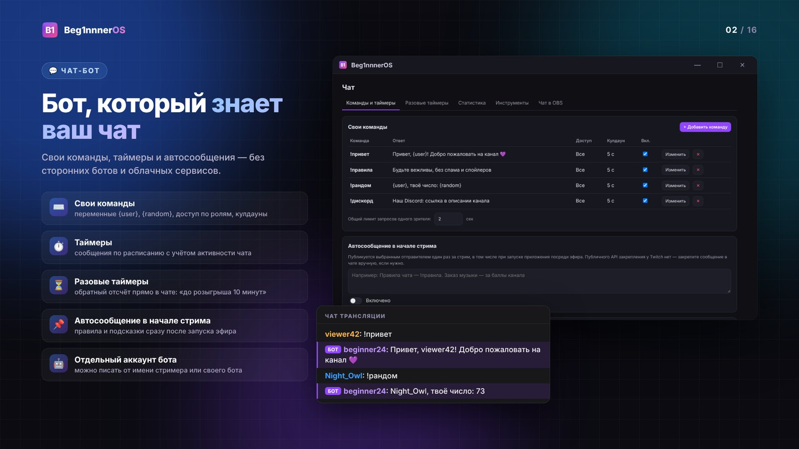

### ✨ МедиаАлерты

Картинки, GIF, видео и звук на экране за баллы канала. Своя награда для каждого алерта, очередь без наложений, остановка одной кнопкой.

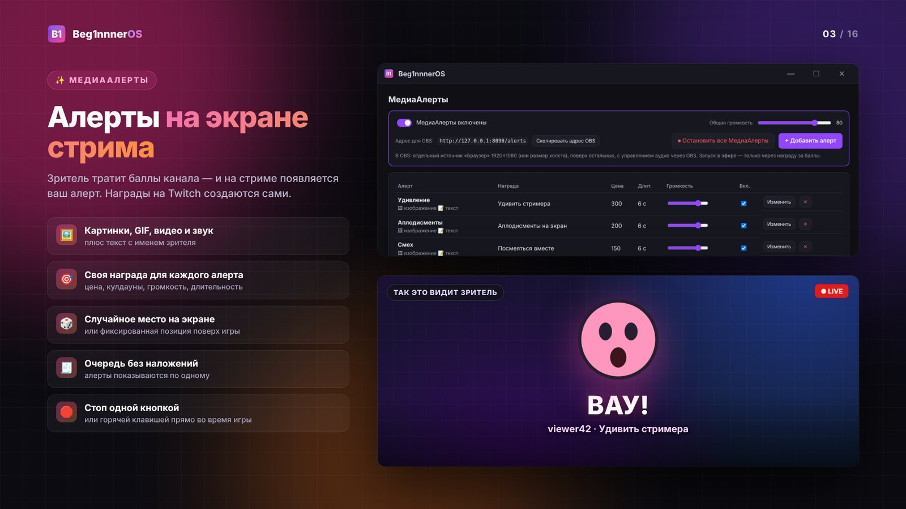

### 🔔 События и DonationAlerts

Бот благодарит за фолловы, подписки, биты, рейды и донаты по вашим шаблонам; пауза уведомлений одной кнопкой.

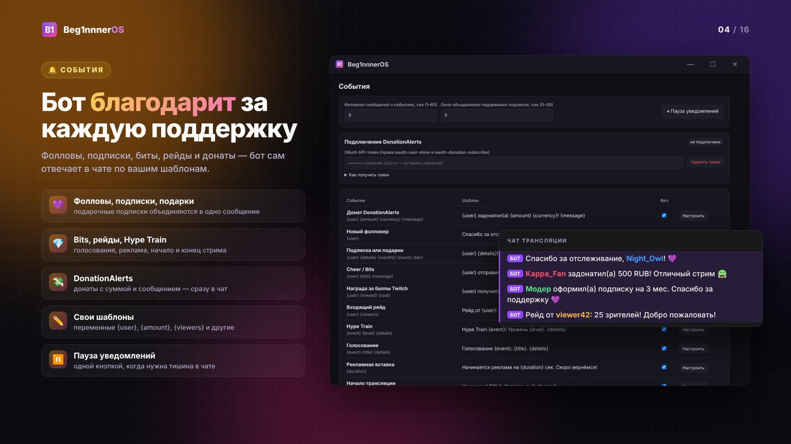

### 🎬 Оверлеи для OBS

Плеер «Сейчас играет» и чат с 7TV/BTTV/FFZ — по 7 готовых тем, удалённые модераторами сообщения пропадают и с экрана.

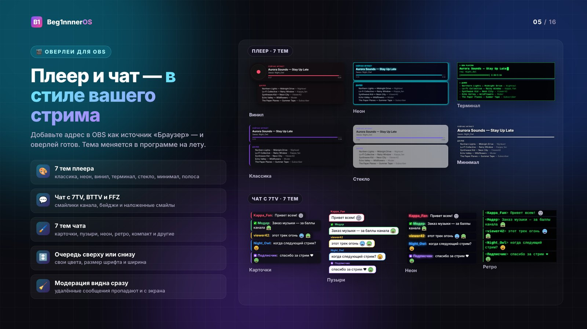

### 🧰 Инструменты

Shazam в чате, перевод чата, исправление раскладки, глобальные горячие клавиши, темы программы, работа в трее.

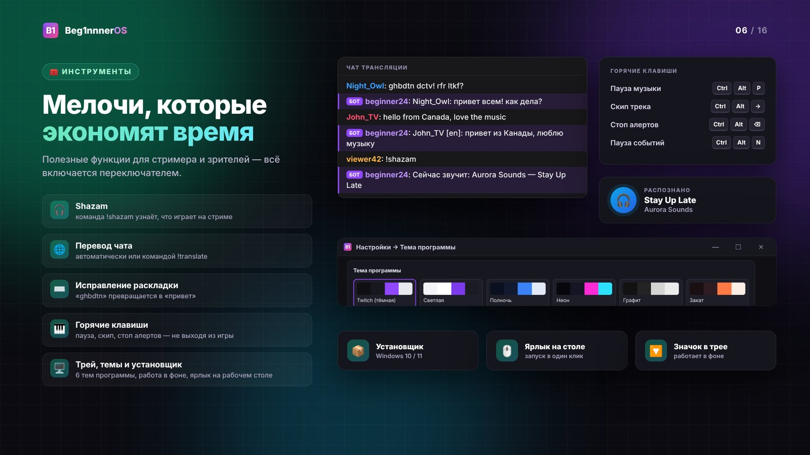

### 🚀 Дополнительно

Статистика стримов с графиком зрителей, розыгрыши и мини-игры, профили для нескольких каналов и копия в облачную папку.

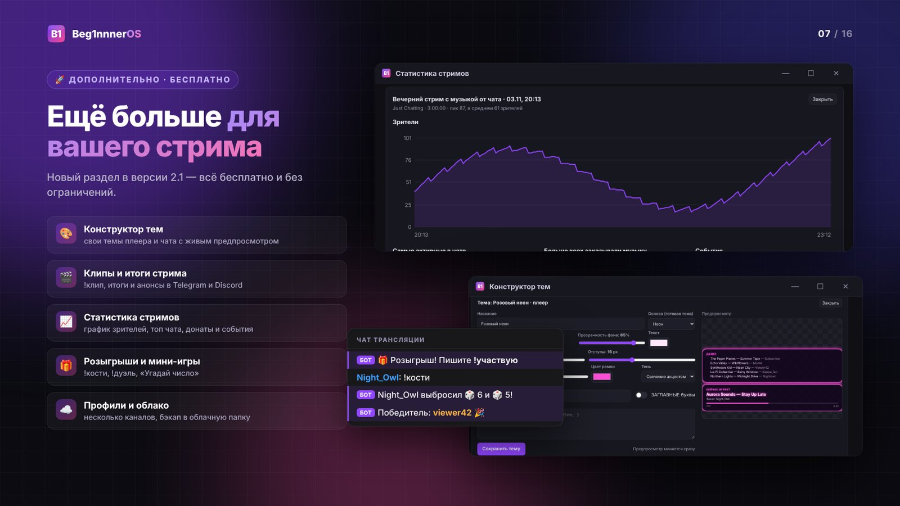

### 🎧 Звук музыки

Выравнивание громкости треков, музыка отдельной дорожкой в OBS, резервный плейлист, команды !очередь, !мойтрек, !отмена.

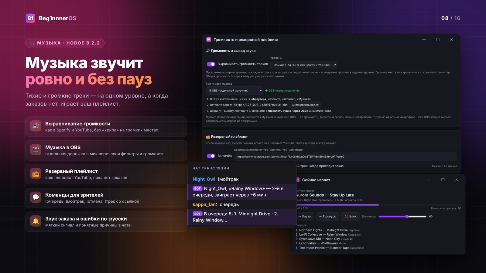

### 🧭 Простой старт

Вход через Twitch по коду без своих ключей, мастер первого запуска, проверка связи с YouTube, автообновление, отчёт об ошибке.

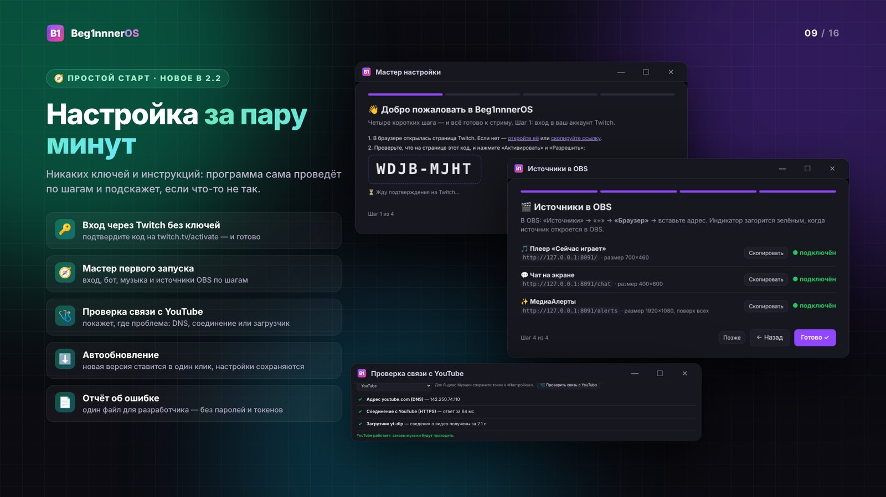

### 🎨 Конструктор тем

Около 40 настроек плеера и чата с живым предпросмотром, 12 палитр, код темы для обмена, 14 звуков нового заказа.

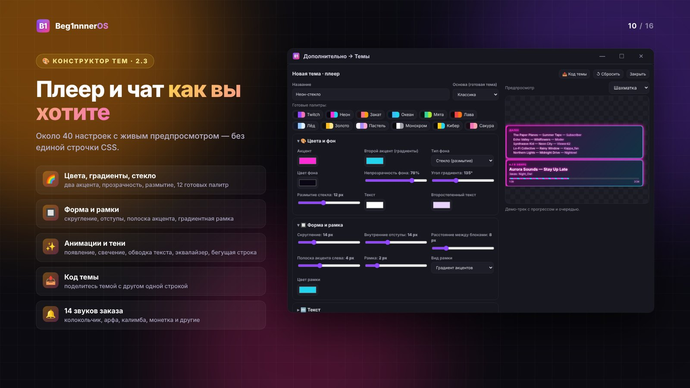

### 📣 Анонсы, клипы и история

Пост в Telegram и Discord при старте эфира, клипы командой !клип, итоги стрима, история треков и повторный заказ из неё.

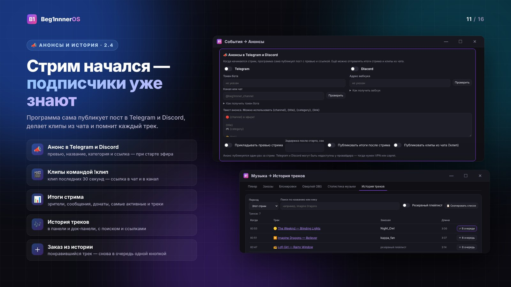

### 🗳 Опросы и прогнозы Twitch

Запуск из программы или док-панели OBS, шаблоны, живые результаты, итоги в чате и полоски голосов на стриме.

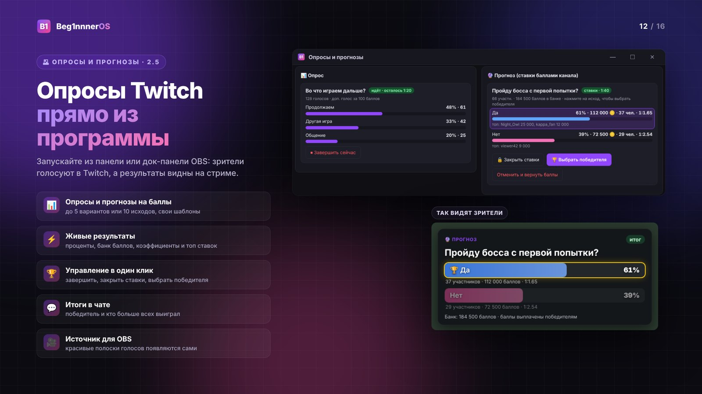

### 🛡 Фильтр спама и ссылок

Ссылки, запрещённые слова (даже замаскированные), капс, повторы и флуд — предупреждение, удаление или таймаут; журнал срабатываний.

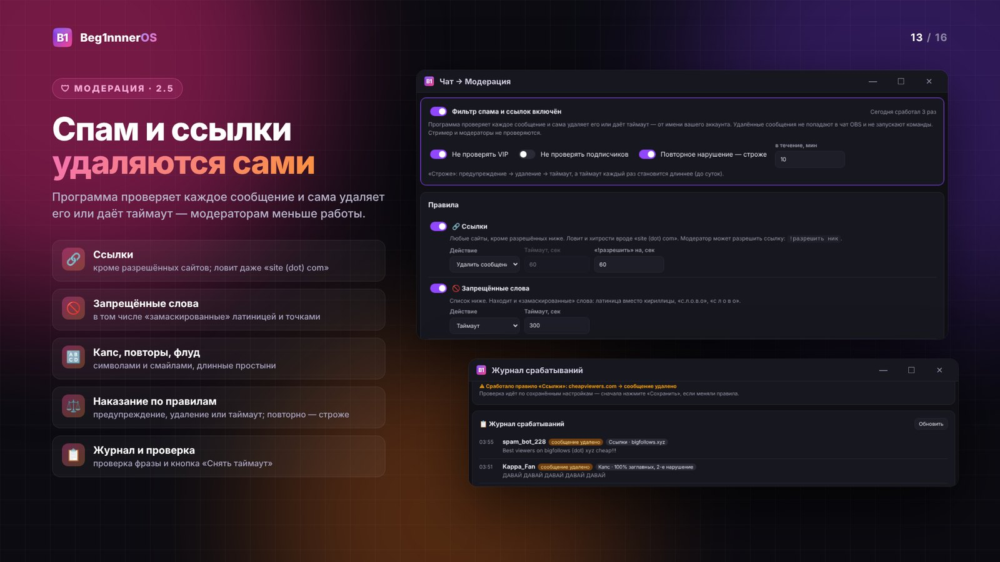

### ⇩ Импорт команд

Команды из Nightbot, StreamElements и moo.bot по нику канала — с переводом переменных и выбором галочками.

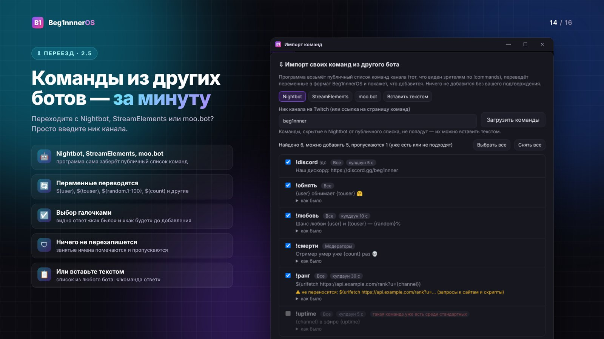

### 🎚 Музыка как на радио

Плавные переходы между треками, лайк трека в резервный плейлист, очередь не теряется при вылете, Яндекс Музыка, если YouTube не работает.

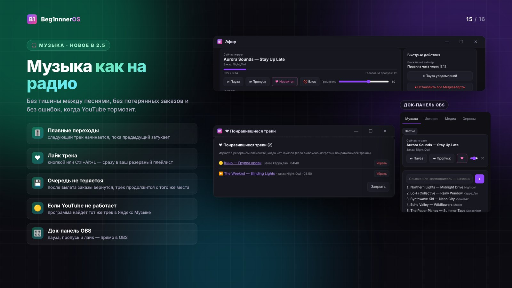

### 🌐 English

Английский язык: панель, источники OBS, ответы бота в чате и посты в Telegram/Discord.

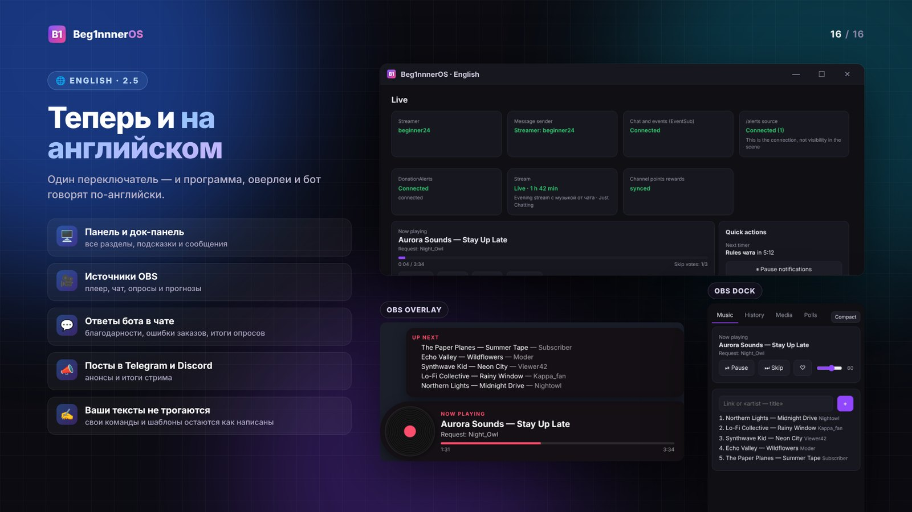

---

# Для разработчиков

C# / WPF + WebView2 + встроенный сервер ASP.NET Core на `127.0.0.1:8080` (для OBS-источников и самого интерфейса), .NET 8.
Установщик собирает GitHub Actions (`.github/workflows/release.yml`).

## Сборка и установщик

**Вариант А — на своём компьютере**

1. Установите [.NET 8 SDK](https://dotnet.microsoft.com/download/dotnet/8.0) (x64)
   и [Inno Setup 6](https://jrsoftware.org/isdl.php).
2. Запустите `build.bat`. Он соберёт программу и установщик.
3. Готовый установщик: `installer\Output\Beg1nnnerOS-Setup-2.0.0.exe`.

**Вариант Б — без установки .NET (GitHub Actions)**

1. Загрузите папку в репозиторий на GitHub.
2. На вкладке **Actions** → **build** в разделе **Artifacts** появятся:
   - `Beg1nnnerOS-Setup` — установщик;
   - `Beg1nnnerOS-portable` — программа без установки.

### Что делает установщик

- Ставит программу в `%LOCALAPPDATA%\Programs\Beg1nnnerOS` — без прав администратора.
  В начале можно выбрать «для всех пользователей», тогда программа встанет в `Program Files`.
- Создаёт ярлык на рабочем столе (галочку можно снять) и пункт в меню «Пуск».
- Если нет Microsoft Edge WebView2 Runtime, скачивает и ставит его сам.
- При обновлении просит закрыть запущенную программу. Настройки сохраняются:
  они лежат отдельно, в `%LOCALAPPDATA%\Beg1nnnerOS`.
- Удаление — через «Параметры → Приложения». В конце программа спросит, удалять ли настройки и данные.

При первом запуске программа скачивает с GitHub (официальные релизы) распакованную сборку yt-dlp
`yt-dlp_win.zip` в `%LOCALAPPDATA%\Beg1nnnerOS\tools\yt-dlp`. Она запускается быстрее однофайлового
`yt-dlp.exe`. Раз в сутки программа проверяет новую версию и обновляется, когда музыка не загружается.
Треки из очереди скачиваются заранее, поэтому следующий начинается сразу.
Если GitHub недоступен, положите `yt-dlp.exe` рядом с `Beg1nnnerOS.exe`.

Для окна нужен **Microsoft Edge WebView2 Runtime**: в Windows 11 он уже есть, в Windows 10 обычно тоже.
Если его нет, программа откроет страницу загрузки.

## Что изменилось по сравнению с Python-версией

| | Python 1.0 | C# 2.0 |
|---|---|---|
| Интерфейс | вкладка браузера | собственное окно (WebView2) |
| Запуск | `start.bat` + Python | `Beg1nnnerOS.exe` |
| Крестик окна | — | спросить / свернуть в трей / закрыть, с запоминанием |
| YouTube | yt-dlp | yt-dlp.exe (скачивается сам, обновляется раз в сутки) |
| Звук | ffmpeg + sounddevice | NAudio (WASAPI) |
| Shazam | shazamio | алгоритм shazam-for-real (ISC), запись через WASAPI loopback |
| Перевод | Argos Translate внутри программы | LibreTranslate: локальный сервер на тех же моделях Argos |
| Горячие клавиши | библиотека keyboard | RegisterHotKey (Windows) |

Настройки, команды, таймеры, алерты, входы Twitch и статистика остаются в том же профиле
`%LOCALAPPDATA%\Beg1nnnerOS`, поэтому программа сразу подхватывает данные Python-версии.
Одно исключение: устройство вывода музыки нужно выбрать заново (в «Настройках»).

### Перевод

Локальные модели Argos не имеют версии для .NET, поэтому перевод идёт через LibreTranslate.
Это бесплатный сервер на тех же моделях, работает на вашем компьютере:

```
pip install libretranslate
libretranslate --load-only en,ru
```

В «Чат → Инструменты» оставьте адрес `http://127.0.0.1:5000` и нажмите «Проверить».

## Дополнительные функции (с версии 2.1.0)

Раздел «🚀 Дополнительно» в программе. Всё бесплатно.

| Функция | Вкладка |
| --- | --- |
| Свои темы оверлеев (цвета, шрифт, скругления, рамка, тень, CSS) для плеера и чата | Темы оверлеев |
| Статистика по каждому стриму: зрители по минутам, чат, фолловы, подписки, биты, донаты, заказы | Статистика стримов |
| Розыгрыши (слово в чате или награда за баллы, шанс ×N для подписчиков, перевыбор) и мини-игры (`!кости`, `!дуэль`, «Угадай число») | Розыгрыши и игры |
| Профили — несколько каналов в одной программе | Профили и облако |
| Облачная копия профиля через папку Яндекс Диска / Google Drive / OneDrive / Dropbox, ключи — зашифрованы паролем | Профили и облако |

## Музыка: звук заказа и ошибки YouTube

- **Звук при новом заказе.** Когда зритель заказывает трек за баллы, играет мягкий сигнал на устройстве вывода музыки.
  Есть 14 звуков: колокольчик, маримба, мягкий аккорд, капля, колокольчики, арфа, калимба, хрусталь, гитара, уведомление, монетка, пузырёк, волшебство и дверной звонок. Звук и громкость выбираются в «Музыка → Источники и ограничения», там же кнопка «▶ Прослушать».
- **Ошибки на русском.** Ошибки YouTube переводятся на русский и пишутся в чат зрителю: 18+, приватное или удалённое видео, блокировка в стране, только для спонсоров и т. п.
  Оригинальный текст yt-dlp остаётся в журнале.
- **Проверка при поиске.** При поиске по названию найденное видео сразу проверяется. Если оно недоступно (например, 18+), берётся следующий результат.
  Если по ссылке пришло недоступное видео, заказ отклоняется сразу, а баллы возвращаются.

## Язык

Программа на русском и английском («Настройки → Язык»). Тексты в коде — русские; английский берётся из словаря `wwwroot/i18n/en.json` (ключ — русская строка или её часть, `{подстановки}` для шаблонов). Страницы переводятся в браузере (`i18n.js`), сообщения в чат и посты — в программе (`Core/I18n.cs`). Новую русскую строку достаточно добавить в словарь.

## OBS

Адреса те же, что раньше:

| Адрес | Источник |
|---|---|
| `http://127.0.0.1:8080/` | музыкальный оверлей (темы: `/?theme=neon` и др.) |
| `http://127.0.0.1:8080/alerts` | МедиаАлерты, 1920×1080 |
| `http://127.0.0.1:8080/dock` | док-панель |
| `http://127.0.0.1:8080/votes` | опросы и прогнозы Twitch, 600×500 (`?preview=1` — демо) |

Звук музыки воспроизводится программой. В OBS должен быть захват системного звука.

## Структура

```
Core/       цикл событий, JSON-настройки, журнал, статистика, резервные копии, Hub
Twitch/     OAuth, Helix, EventSub (WebSocket)
Features/   команды, таймеры, события, музыка, плеер, Яндекс, награды, алерты,
            Shazam, перевод, раскладка, DonationAlerts
Shazam/     алгоритм отпечатка (shazam-for-real, ISC License)
Web/        сервер ASP.NET Core и API для интерфейса
Desktop/    горячие клавиши, диалог закрытия, открытие ссылок
wwwroot/    интерфейс (панель, оверлей, алерты, док)
```

Вся логика выполняется в одном потоке (`HubLoop`), как в Python-версии на asyncio, поэтому общие
данные не требуют блокировок.

## Громкость и вывод музыки

- **Выравнивание громкости.** При загрузке трека программа измеряет его громкость по стандарту EBU R128 и подстраивает усиление до выбранного уровня (−18 / −14 / −11 LUFS, не больше ±12 дБ). Измерения кэшируются в `cache/loudness.json`.
- **Музыка в OBS.** В «Музыка → Источники и ограничения → Громкость и вывод звука» выберите «В OBS» и добавьте в OBS источник «Браузер» с адресом `http://127.0.0.1:<порт>/music-obs`, включив «Управлять аудио через OBS». Если страница не отвечает дольше 4 секунд или не может открыть файл, трек продолжает играть в программе с того же места.

## Обновления через GitHub

Программа через 5 секунд после запуска, затем каждый час (и при открытии панели) проверяет последний релиз в репозитории, указанном в `Core/Updater.cs` (`Repo`).
Если номер версии на GitHub больше, в панели появляются плашка «Доступна новая версия» и кнопка «⬇ Обновить» в боковом меню, а Windows показывает уведомление.
Программа скачивает установщик, проверяет контрольную сумму, тихо ставит обновление в ту же папку и перезапускается.
Настройки при этом не трогаются: они лежат в `%LOCALAPPDATA%`, а не в папке программы.

Как выпустить новую версию:

1. Поднимите номер версии в четырёх местах: `Core/Config.cs` (`Version`), `Beg1nnnerOS.csproj` (`<Version>`), `build.bat` (`VERSION`), `installer/Beg1nnnerOS.iss` (`AppVersion`).
2. Допишите раздел `## X.Y.Z` в `CHANGELOG.md`: этот текст покажет кнопка «Что нового».
3. Загрузите изменения и тег: `git commit -am "2.1.2" && git tag v2.1.2 && git push && git push origin v2.1.2`.
4. GitHub Actions (`.github/workflows/release.yml`) соберёт установщик на Windows и опубликует релиз с приложенным `Beg1nnnerOS-Setup-X.Y.Z.exe`. Это занимает около 5 минут.

Можно и вручную: собрать `build.bat`, затем на GitHub открыть **Releases → Draft a new release**, поставить тег `vX.Y.Z`, приложить установщик и нажать **Publish release**. Черновики и pre-release программа не видит.

Репозиторий должен быть публичным: программа обращается к GitHub без авторизации.

## Благодарности

Словари частых слов для исправления раскладки (`Data/words_*.txt.gz`) — из проекта
[FrequencyWords](https://github.com/hermitdave/FrequencyWords) (Hermit Dave, данные OpenSubtitles, CC BY-SA 4.0).
